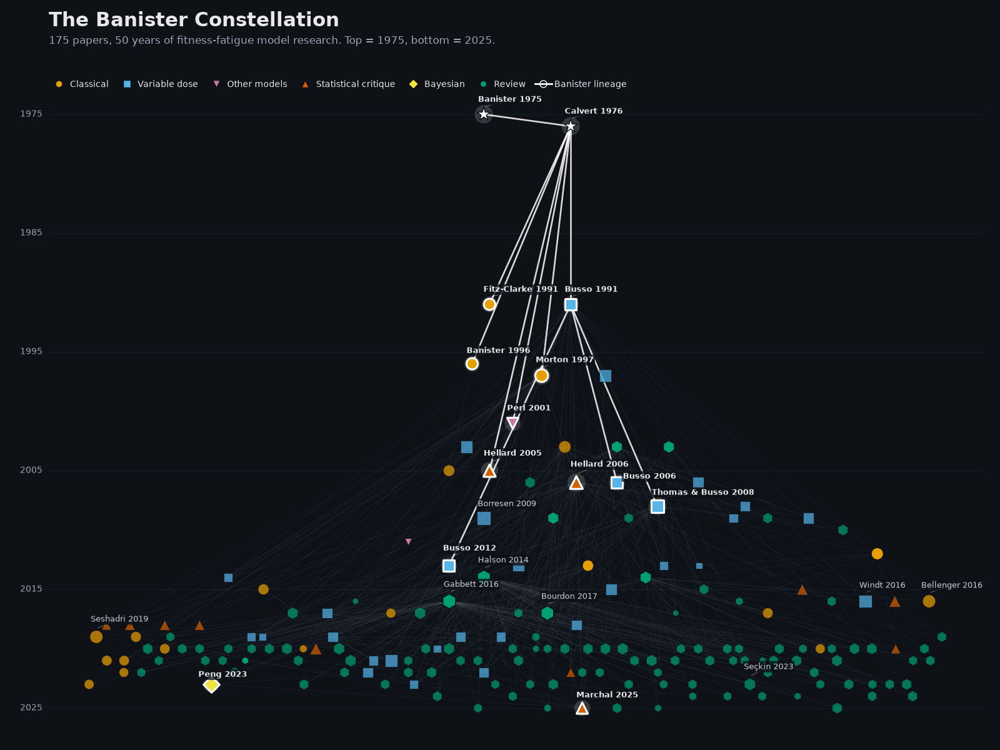

# The Banister Constellation

> An interactive citation network of the fitness-fatigue model (FFM)
> literature lineage. 175 papers, 524 edges, anchored on
> **Banister 1975** + **Calvert 1976**.



[**▶ Open the live interactive →**](https://jacobbowie.com/citation-network/) ·
[case study](https://jacobbowie.com/citation-network/) ·
[methodology](https://github.com/JacobBowie/citation-network#how-it-works)

## What this is

A constellation view of fifty years of fitness-fatigue model literature.
Every node is a paper, every edge a citation. Gold halos mark the 14-paper
Banister lineage chain reconstructed from `parent_doi` annotations; colors
code the methodological family (classical, variable-dose, statistical
critique, Bayesian hierarchical, PerPot, review).

The underlying corpus is the local `getpaid` literature pipeline — a
DuckDB index of Semantic Scholar forward citations and CrossRef references,
filtered to FFM-adjacent work. The trunk is curated (25 founding-equation
papers); the extension layer is auto-expanded and family-classified by
which trunk papers it cites most.

## What ships

| Artifact | Size | Use |
|---|---|---|
| `dist/index.html` | ~27 MB | Interactive **marimo WASM** bundle — full Pyodide kernel + reactive controls |
| `dist/standalone.html` | ~320 KB | Pure **vis-network HTML** — instant load, no Pyodide |
| `dist_static/citation_network.png` | ~200 KB | Hero PNG (1600×1200) |
| `dist_static/citation_network_card.png` | ~86 KB | OG/Twitter card (1200×630, minimal) |
| `dist_static/citation_network_card_labeled.png` | ~113 KB | OG/Twitter card with seed labels |
| `public/data/{nodes,edges}.csv` | ~83 KB | Canonical CSV data, shipped in repo |

The marimo WASM bundle and the standalone HTML render the **same**
visualization — same dataset, same colors, same Banister-lineage gold halos.
The marimo path adds reactive sliders (year range, citation threshold,
family filters) at the cost of a ~30-60 s Pyodide cold start. The
standalone path loads instantly and is recommended as the default route.

## How it works

```
data/lineage_figure/canonical_ffm_seeds.csv  ── 25 curated FFM founding papers
                          │
            extract.py ───┴─── DuckDB (portfolio.duckdb, private)
                                  ├── forward citations  (Semantic Scholar)
                                  ├── backward references (CrossRef)
                                  └── extension-family inference
                                            │
                                            └─ public/data/{nodes,edges}.csv
                                                      │
                                                      ├─ notebook.py  →  dist/index.html  (marimo WASM)
                                                      ├─ build_html.py →  dist/standalone.html
                                                      └─ render_static.py → dist_static/*.png
```

`extract.py` is an **optional refresh tool** — it requires the private
DuckDB and the seed CSV from the upstream `getpaid` repo. The committed
`public/data/{nodes,edges}.csv` are canonical; the build pipeline (and CI)
reads those directly with `--skip-extract`.

## Build

```bash
# One-time: vendor vis-network locally (avoids CDN SPOF at deploy time)
mkdir -p public/vendor
curl -sSL -o public/vendor/vis-network-9.1.9.min.js \
    https://unpkg.com/vis-network@9.1.9/standalone/umd/vis-network.min.js

# Install deps
pip install -r requirements.txt

# Run tests
pytest tests/

# Build all three artifacts from committed CSVs
bash deploy/build_wasm.sh --skip-extract

# (Optional) refresh CSVs from upstream DuckDB — requires private corpus
python extract.py --top-k 150
```

Smoke-test locally:

```bash
python -m http.server --directory dist 8000
# → http://localhost:8000/                  (marimo WASM)
# → http://localhost:8000/standalone.html   (pure HTML)
```

## Deploy

This repo cuts releases as GitHub Releases tarballs. The portfolio site
(`jacobbowie-site`) pulls them at build time and mounts them under
`/citation-network/`. See [`deploy/case_study_citation_network.qmd`](deploy/case_study_citation_network.qmd)
for the case-study landing page template.

```bash
git tag v0.1.0
git push origin v0.1.0
# → CI builds + bundles + attaches WASM tarball, standalone tarball,
#   and the three PNGs to the release.
```

## Provenance and known limits

- **Banister 1975 has no DOI.** It uses the synthetic key `manual:banister1975`
  throughout the data layer. The 1976 IEEE paper (Calvert et al.) is the
  earliest paper with a real DOI in the lineage.
- **Citation counts are sparse for older / non-DOI papers.** Citation count
  is from Semantic Scholar's `citationCount` field, which doesn't always
  resolve for pre-1990 work. Seeds with no DB entry default to `0`.
- **Extension layer is a snapshot.** Top-150 most-linked neighbors at build
  time. Re-running `extract.py` against a refreshed DuckDB will pick up
  newer papers.

## License

- **Code** — MIT
- **Data** (committed CSVs + static PNGs) — CC-BY-4.0
- **Third-party** — `public/vendor/vis-network-9.1.9.min.js` is Apache-2.0
  (visjs/vis-network).

See [`LICENSE`](LICENSE) for full text.

## Cite

```bibtex
@software{bowie2026banister_constellation,
  author = {Bowie, Jacob},
  title  = {The Banister Constellation: a citation network of the fitness-fatigue model lineage},
  year   = {2026},
  version = {0.1.1},
  url    = {https://github.com/JacobBowie/citation-network}
}
```
